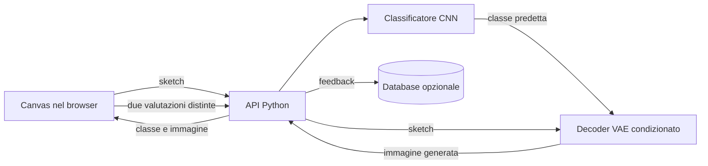

# Deploy di GENSKETCH: prima architettura applicativa

Questo documento descrive come trasformare GENSKETCH, **una volta completati e valutati i modelli**, in un'applicazione web. L'obiettivo è permettere a una persona di disegnare uno sketch, ottenere un'immagine più completa e valutare separatamente il riconoscimento della categoria e il risultato generato. È un piano di deploy, non la descrizione di un'applicazione già pronta.

## Flusso dell'applicazione

Il classificatore riconosce la categoria dello sketch. Il decoder riceve **lo stesso sketch, la classe predetta e il vettore latente** e genera l'immagine. In base all'architettura attualmente descritta nel progetto, l'output è in scala di grigi e punta a essere un disegno completo e dettagliato. La somiglianza con una fotografia è un obiettivo da verificare sui risultati effettivi del VAE, non una proprietà garantita dal deploy.

## Frontend

Una singola pagina può essere sufficiente per la prima versione:

1. Un'area di disegno utilizzabile con mouse, penna e touch, con pulsanti per cancellare e ricominciare.
2. Un pulsante **Genera** che invia lo sketch solo quando l'utente lo richiede. Il canvas esporta un'immagine PNG; il backend la porta alla dimensione, ai colori e alla normalizzazione attesi dai modelli.
3. Durante l'elaborazione, un'animazione di caricamento o una transizione grafica. Deve indicare che la richiesta è in corso, senza simulare una percentuale di avanzamento che il server non conosce.
4. Sotto al canvas, comparsa dell'immagine generata e della categoria riconosciuta. L'utente può riprovare o salvare l'immagine.
5. Due domande **indipendenti**: «La categoria riconosciuta è corretta?» e «L'immagine generata è accettabile?», ciascuna con risposta sì/no e possibilità di non rispondere. Se la prima risposta è “no”, si può offrire la scelta della categoria corretta.

La valutazione dell'immagine non deve essere dedotta da quella della categoria: una classificazione corretta può produrre un'immagine insoddisfacente, e viceversa.

## Backend Python e contratti API

[FastAPI](https://fastapi.tiangolo.com/tutorial/request-files/) è una scelta pratica per ricevere il PNG e definire gli endpoint. Per una prima versione bastano:

| Endpoint | Input | Output |
| --- | --- | --- |
| `POST /api/generate` | PNG dello sketch | `request_id`, `predicted_category`, eventuale `confidence`, immagine generata |
| `POST /api/feedback` | `request_id`, `predicted_category`, `model_version`, `classification_correct`, `generation_acceptable`, eventuale `correct_category` | Conferma di ricezione |
| `GET /health` | Nessuno | Stato del servizio e disponibilità dei modelli |

Per il primo rilascio, l'immagine può essere restituita come PNG codificato in Base64 nella risposta JSON: evita di dover mantenere file temporanei e associa subito immagine e categoria alla stessa richiesta. Se le immagini o il traffico crescono, conviene passare a un file/URL temporaneo oppure a una risposta binaria con metadati gestiti separatamente.

All'avvio, il backend carica **una volta sola** i pesi del classificatore e del decoder, insieme alla mappa ID → categoria e alla configurazione di preprocessing. Per ogni richiesta valida: decodifica e prepara lo sketch con le *stesse* trasformazioni usate in valutazione, esegue il classificatore, passa sketch e classe predetta al decoder, converte l'output nel formato immagine e lo restituisce. In PyTorch, entrambi i modelli vanno messi in `eval()` e l'inferenza può avvenire sotto `torch.inference_mode()`; le due operazioni hanno ruoli diversi ([documentazione PyTorch](https://docs.pytorch.org/docs/stable/generated/torch.autograd.grad_mode.inference_mode.html)).

L'API dovrebbe rifiutare file non immagine, troppo grandi o vuoti, e dare un errore comprensibile se il modello non riesce a generare il risultato. Il `request_id` collega la risposta al feedback; la versione dei pesi permette di confrontare valutazioni raccolte in momenti diversi. Per un servizio pubblico serviranno anche un limite alle richieste e il monitoraggio della latenza. Se frontend e API sono ospitati su domini differenti, configurare esplicitamente le origini consentite tramite [CORS](https://fastapi.tiangolo.com/tutorial/cors/); ospitarli sulla stessa origine semplifica il primo deploy.

## Database leggero: facoltativo

Si può iniziare senza database registrando i feedback in un file JSONL su un volume persistente. Per una singola istanza, [SQLite tramite `sqlite3`](https://docs.python.org/3/library/sqlite3.html) offre poi ricerche e aggregazioni più comode; anche il suo file deve risiedere su un volume persistente, altrimenti sparisce quando il container viene sostituito. Se il servizio passa a più istanze o richiede scritture concorrenti frequenti, valutare PostgreSQL.

Una tabella `feedback` può contenere `request_id`, `created_at`, `model_version`, `predicted_category`, `classification_correct`, `generation_acceptable` e `correct_category` facoltativa. Le due valutazioni devono restare colonne separate e ammettere l'assenza di risposta. Salvare sketch e immagini generate è una scelta distinta: farlo solo se serve a una valutazione o a un futuro riaddestramento e dopo averlo spiegato chiaramente all'utente. Non occorre conservare le immagini per registrare i due voti.

## Percorso concreto verso il deploy

1. **Congelare un modello finale.** Dopo la validazione, produrre pesi finali del classificatore e del decoder, mappa delle classi, dimensione di input/output e preprocessing. Testare l'intera catena su sketch mai visti, compresi casi in cui il classificatore sbaglia. Il checkpoint “migliore” di un singolo fold non è automaticamente il modello finale dell'applicazione.
2. **Separare l'inferenza dal training.** Esporre una funzione Python che riceve un'immagine e restituisce categoria e PNG. Verificare che caricamento e trasformazioni funzionino senza dataset di training e senza notebook Kaggle.
3. **Implementare API e pagina web.** Collegare canvas, endpoint di generazione, visualizzazione del risultato e feedback. Un test end-to-end deve coprire il percorso reale dal browser alla risposta.
4. **Misurare risorse e tempi.** Provare prima CPU e poi, se la latenza è eccessiva, un host con GPU. Il numero di worker va scelto considerando che ogni processo può caricare una copia dei pesi in memoria.
5. **Distribuire.** Una soluzione iniziale è un singolo host con frontend statico, API FastAPI e, se usato, SQLite su volume persistente. Un'immagine [Docker per FastAPI](https://fastapi.tiangolo.com/deployment/docker/) rende ripetibile l'ambiente; HTTPS, configurazione e file dei modelli vanno predisposti sull'host. I pesi versionati sono artefatti di rilascio, non codice sorgente da aggiungere necessariamente a Git.

La prima versione può usare **una sola istanza** e richieste sincrone se i tempi misurati sono accettabili. Una coda di lavori con polling o notifiche ha senso solo se la generazione richiede abbastanza tempo da rendere scomoda una normale richiesta HTTP.

## Costo di deploy ed esecuzione in cloud

**Obiettivo: 0 € di spesa ricorrente**, compatibilmente con il tempo di risposta del modello e con i limiti dei piani gratuiti. Il progetto può restare gratuito per gli utenti senza che l'infrastruttura sia necessariamente gratuita per chi lo ospita: il costo dipende soprattutto da dove gira l'inferenza, per quante ore e se richiede una GPU.

| Componente | Possibile soluzione a costo cloud zero | Vincolo da verificare |
| --- | --- | --- |
| Frontend statico | Servirlo dalla stessa VM dell'API oppure usare [GitHub Pages](https://docs.github.com/en/pages/quickstart) con un repository pubblico | GitHub Pages ospita la pagina, non esegue l'inferenza Python. |
| API Python + modelli | Una VM CPU [Oracle Cloud Always Free](https://docs.oracle.com/en-us/iaas/Content/FreeTier/freetier_topic-Always_Free_Resources.htm), entro le risorse incluse | Provare installazione PyTorch su ARM, RAM occupata, latenza e disponibilità della VM nella regione scelta. |
| Feedback | SQLite o JSONL sul disco della stessa VM | Prevedere backup; mantenere disco e traffico entro le quote gratuite. |
| GPU dedicata | Nessuna nella configurazione iniziale | Se la CPU è troppo lenta, il costo di inferenza va rivalutato. |

Per rendere concreta la proposta: Oracle indica come risorse Always Free fino a **2 OCPU e 12 GB di RAM su Ampere A1**, oltre a **200 GB complessivi di volumi** nella regione principale dell'account. In teoria una VM di queste dimensioni può ospitare pagina, FastAPI, pesi e piccolo database senza un canone mensile, purché **tutte** le risorse create siano contrassegnate come Always Free e rimangano nelle quote. La disponibilità della VM non è garantita in ogni momento o regione. Inoltre, CPU gratuita non significa risposta rapida: prima del deploy occorre misurare il tempo per classificazione più generazione su quella macchina. Oracle richiede di norma una carta per creare l'account, pur senza addebitarla finché non si passa a un piano a pagamento ([registrazione](https://docs.oracle.com/en-us/iaas/Content/FreeTier/freetier.htm), [risorse e limiti](https://docs.oracle.com/en-us/iaas/Content/FreeTier/freetier_topic-Always_Free_Resources.htm)).

Una GPU sempre attiva cambia l'ordine di grandezza. A titolo di esempio, il listino [Hugging Face Spaces](https://huggingface.co/pricing) riporta una **T4 small a 0,40 dollari/ora**: 24 ore al giorno per 30 giorni corrispondono a circa **288 dollari**, mentre un'ora al giorno corrisponde a circa **12 dollari**, prima di eventuali altri costi. Sono esempi aritmetici, non un preventivo per GENSKETCH. GPU gratuite condivise e a quota, come [ZeroGPU](https://huggingface.co/docs/hub/en/spaces-zerogpu), possono servire per una demo, ma impongono limiti d'uso e una soluzione applicativa diversa dal semplice servizio FastAPI sempre disponibile. Inoltre, il piano CPU Basic degli Spaces ha prezzo orario zero, ma [la creazione di nuovi Space Gradio o Docker richiede attualmente un piano a pagamento](https://huggingface.co/docs/hub/en/spaces-overview): non va quindi considerato automaticamente un deploy gratuito end-to-end.

Un'alternativa gratuita per provare l'API Python è [Render Free](https://render.com/docs/free), ma il suo [piano web gratuito offre 0,1 CPU e 512 MB RAM](https://render.com/docs/compute-plans), non include un disco persistente e il servizio va in sospensione quando resta inattivo. Per PyTorch più classificatore e VAE potrebbe non bastare: si decide solo misurando memoria e latenza dei modelli finali. Il database gratuito di Render ha inoltre una durata limitata; non è la scelta più semplice per conservare feedback a lungo.

La decisione pratica, dopo aver completato i modelli, è: **misurare inferenza e RAM su CPU → provare una VM Always Free → mantenere il deploy a 0 € se l'esperienza è accettabile**. Se non lo è, si può ridurre il costo con un modello più leggero o una demo accessibile solo in finestre programmate; una GPU dedicata continuativa sarebbe una spesa volontaria. Un dominio personalizzato è facoltativo: gli indirizzi forniti dalle piattaforme evitano quel costo. Le condizioni dei piani possono cambiare, quindi ricontrollare listini e quote prima di creare le risorse.

## Come uscire dal solo proof of concept

Il caso d'uso più vicino all'architettura attuale è **ideazione visiva rapida**: un utente disegna una forma grezza e ottiene più proposte da cui partire per un'illustrazione, una scheda didattica o un concept. Per renderlo utile servono almeno varianti della stessa idea, possibilità di correggere la categoria, download e una misura del tempo risparmiato o della quota di risultati effettivamente utilizzati. Il limite delle categorie supportate va mostrato nell'interfaccia.

Una seconda direzione è un **ausilio alla creazione di simboli visivi personalizzati**: chi prepara materiali educativi o comunicativi può trasformare schizzi semplici in immagini più leggibili e scegliere quella migliore. Qui conta soprattutto che il soggetto rimanga riconoscibile; il feedback dell'utente è un indicatore diretto di utilità.

Un'estensione più impegnativa è la **ricerca in un catalogo a partire da uno sketch**: disegnare un oggetto per trovare immagini o prodotti corrispondenti. Richiederebbe un modulo di ricerca su un catalogo reale e metriche di recupero, oltre al classificatore e al generatore attuali. Può diventare un'applicazione forte, ma è un nuovo obiettivo tecnico da aggiungere consapevolmente.

Prima di ampliare l'architettura, conviene testare una di queste attività con utenti reali. Le misure utili sono: correttezza della categoria per classe, percentuale di immagini giudicate accettabili, percentuale di risultati scaricati/usati e tempo di risposta. Se questi numeri e gli esempi mostrano un vantaggio concreto, il progetto ha già una storia applicativa convincente; un secondo progetto serve solo se vuoi esplorare un problema diverso.
